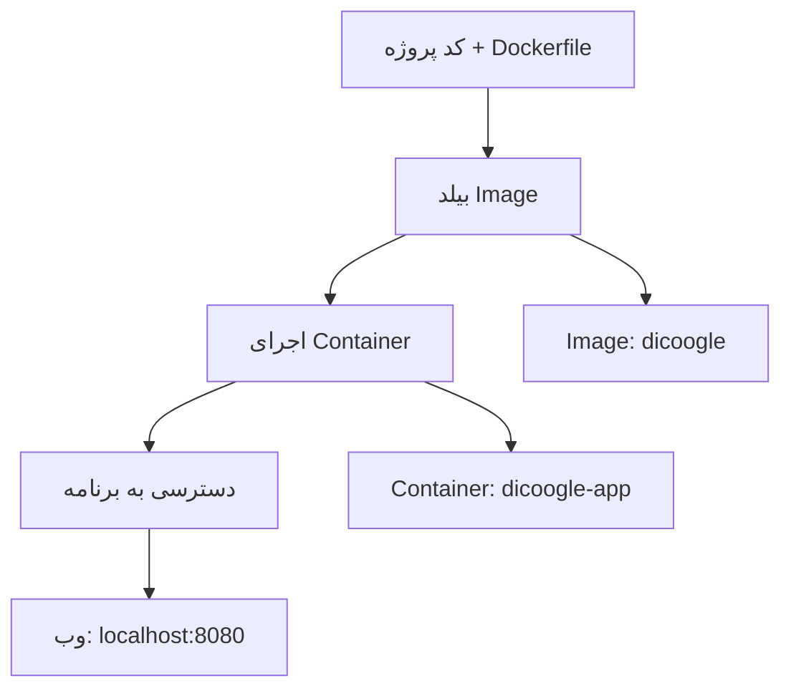

# راهنمای کامل Docker برای پروژه Dicoogle

## 📋 فهرست مطالب

- [معرفی](#معرفی)
- [آشنایی سریع با Docker](#-آشنایی-سریع-با-docker)
- [پیش‌نیازها](#پیش‌نیازها)
- [نصب Docker](#نصب-docker)
- [بیلد پروژه](#بیلد-پروژه)
- [اجرای پروژه](#اجرای-پروژه)
- [استفاده از پروژه](#استفاده-از-پروژه)
- [مدیریت کانتینر](#مدیریت-کانتینر)
- [عیب‌یابی](#عیب‌یابی)
- [سوالات متداول](#سوالات-متداول)

## معرفی

Dicoogle یک نرم‌افزار PACS (Picture Archiving and Communication System) متن‌باز و قابل توسعه است که برای ذخیره، مدیریت و
بازیابی تصاویر پزشکی DICOM طراحی شده است. این راهنما نحوه بیلد، اجرا و استفاده از Dicoogle با استفاده از Docker را آموزش
می‌دهد.

## 🐳 آشنایی سریع با Docker

### Docker چیست؟

Docker یک پلتفرم کانتینری‌سازی است که به شما امکان بسته‌بندی و اجرای برنامه‌ها در محیط‌های ایزوله را می‌دهد. به جای نصب
مستقیم نرم‌افزار روی سیستم، آن را در یک "کانتینر" اجرا می‌کنید.

### مفاهیم اصلی Docker:

#### 1. **Image (تصویر)**

- یک قالب آماده برای ایجاد کانتینر
- شامل سیستم‌عامل، نرم‌افزارها و تنظیمات
- مثال: `dicoogle` که ما می‌سازیم

#### 2. **Container (کانتینر)**

- یک نمونه اجرا شده از Image
- محیط ایزوله برای اجرای برنامه
- مثال: `dicoogle-app` که اجرا می‌کنیم

#### 3. **Dockerfile**

- فایل متنی که نحوه ساخت Image را تعریف می‌کند
- شامل دستورات نصب و پیکربندی

### روند کاری Docker در پروژه Dicoogle:



### دستورات اساسی Docker:

```bash
# ساخت Image از Dockerfile
docker build -t dicoogle .

# اجرای Container از Image
docker run -d --name dicoogle-app dicoogle

# مشاهده Container های در حال اجرا
docker ps

# مشاهده لاگ های Container
docker logs dicoogle-app

# توقف Container
docker stop dicoogle-app

# حذف Container
docker rm dicoogle-app
```

### مزایای استفاده از Docker برای Dicoogle:

✅ **سادگی**: بدون نیاز به نصب Java، Maven و وابستگی‌ها  
✅ **ایزولاسیون**: برنامه در محیط جداگانه اجرا می‌شود  
✅ **قابلیت حمل**: روی هر سیستم‌عامل اجرا می‌شود  
✅ **مدیریت آسان**: شروع، توقف و حذف با یک دستور  
✅ **عدم تداخل**: با برنامه‌های دیگر تداخل ندارد

### مثال عملی:

```bash
# مرحله 1: ساخت Image
docker build -t dicoogle .

# مرحله 2: اجرای Container
docker run -d -p 8080:8080 --name dicoogle-app dicoogle

# مرحله 3: دسترسی به برنامه
# مرورگر → http://localhost:8080
```

## پیش‌نیازها

### سیستم‌عامل

- Linux (Ubuntu 18.04+ توصیه می‌شود)
- Windows 10/11 با WSL2
- macOS 10.15+

### نرم‌افزارهای مورد نیاز

- Docker Engine 20.10+
- Docker Compose (اختیاری)
- Git
- حداقل 4GB RAM
- حداقل 10GB فضای خالی

## نصب Docker

### Ubuntu/Debian

```bash
# به‌روزرسانی پکیج‌ها
sudo apt update

# نصب Docker
sudo apt install docker.io docker-compose

# اضافه کردن کاربر به گروه docker
sudo usermod -aG docker $USER

# راه‌اندازی سرویس Docker
sudo systemctl start docker
sudo systemctl enable docker

# خروج و ورود مجدد برای اعمال تغییرات
exit
```

### CentOS/RHEL

```bash
# نصب Docker
sudo yum install docker docker-compose

# راه‌اندازی سرویس
sudo systemctl start docker
sudo systemctl enable docker

# اضافه کردن کاربر به گروه docker
sudo usermod -aG docker $USER
```

### Windows

1. Docker Desktop را از [docker.com](https://www.docker.com/products/docker-desktop) دانلود کنید
2. فایل نصب را اجرا کنید
3. پس از نصب، Docker Desktop را راه‌اندازی کنید

### macOS

1. Docker Desktop را از [docker.com](https://www.docker.com/products/docker-desktop) دانلود کنید
2. فایل DMG را اجرا کنید
3. Docker.app را به پوشه Applications بکشید
4. Docker Desktop را راه‌اندازی کنید

## بیلد پروژه

### 1. کلون کردن پروژه

```bash
# کلون کردن ریپوزیتوری
git clone https://github.com/bioinformatics-ua/dicoogle.git
cd dicoogle
```

### 2. بررسی Dockerfile

فایل `Dockerfile` در ریشه پروژه قرار دارد:

```dockerfile
FROM openjdk:8

WORKDIR /root

RUN apt-get update && \
    apt-get install -y software-properties-common build-essential git maven

RUN git clone https://github.com/bioinformatics-ua/dicoogle
RUN ( cd dicoogle && mvn install && ln -s /root/dicoogle/dicoogle/target/dicoogle.jar /root/ )

CMD ["java","-jar","dicoogle.jar","-s"]
```

### 3. بیلد Docker Image

```bash
# بیلد کردن image با نام dicoogle
docker build -t dicoogle .

# بیلد با تگ خاص
docker build -t dicoogle:v3.5.1 .
```

### 4. بررسی Image ساخته شده

```bash
# مشاهده لیست images
docker images

# مشاهده جزئیات image
docker inspect dicoogle
```

## اجرای پروژه

### 1. اجرای ساده

```bash
# اجرای کانتینر در پس‌زمینه
docker run -d --name dicoogle-app dicoogle

# اجرای کانتینر با پورت مشخص
docker run -d -p 8080:8080 --name dicoogle-app dicoogle
```

### 2. اجرای پیشرفته

```bash
# اجرای با پورت‌های مختلف
docker run -d \
  -p 8080:8080 \
  -p 6666:6666 \
  -p 1045:1045 \
  --name dicoogle-app \
  dicoogle
```

### 3. اجرای با Volume

```bash
# اجرای با volume برای ذخیره داده‌ها
docker run -d \
  -p 8080:8080 \
  -v dicoogle-data:/root/dicoogle/data \
  -v dicoogle-plugins:/root/dicoogle/Plugins \
  --name dicoogle-app \
  dicoogle
```

### 4. اجرای با متغیرهای محیطی

```bash
docker run -d \
  -p 8080:8080 \
  -e JAVA_OPTS="-Xmx2g -Xms1g" \
  --name dicoogle-app \
  dicoogle
```

## استفاده از پروژه

### 1. دسترسی به رابط کاربری

پس از اجرای کانتینر، می‌توانید از طریق مرورگر به آدرس زیر دسترسی پیدا کنید:

```
http://localhost:8080
```

### 🔐 اطلاعات ورود پیش‌فرض

Dicoogle دارای یک کاربر پیش‌فرض با دسترسی ادمین است:

- **نام کاربری**: `dicoogle`
- **رمز عبور**: `dicoogle`

> ⚠️ **نکته امنیتی**: حتماً پس از اولین ورود، رمز عبور پیش‌فرض را تغییر دهید!

### 2. پورت‌های مختلف

- **8080**: رابط کاربری وب
- **6666**: DICOM Storage SCP
- **1045**: DICOM Query/Retrieve

### 3. ویژگی‌های اصلی

#### مدیریت پلاگین‌ها

- در صفحه Management می‌توانید پلاگین‌ها را مدیریت کنید
- پلاگین‌های پیش‌فرض شامل Lucene Index و File Storage هستند

#### ایندکس کردن فایل‌ها

1. به صفحه Indexer بروید
2. مسیر دایرکتوری حاوی فایل‌های DICOM را انتخاب کنید
3. روی دکمه Start کلیک کنید

#### جستجو

- از صفحه Search برای جستجوی فایل‌های DICOM استفاده کنید
- پشتیبانی از جستجوی متن آزاد و جستجوی پیشرفته

#### مدیریت کاربران

- در صفحه Management می‌توانید کاربران جدید اضافه کنید
- رمز عبور کاربران را تغییر دهید
- نقش‌های کاربری را مدیریت کنید

### 4. API های REST

```bash
# جستجو
curl "http://localhost:8080/search?query=Modality:CT"

# دریافت اطلاعات یک تصویر
curl "http://localhost:8080/dump?uid=SOPInstanceUID"

# دانلود فایل DICOM
curl "http://localhost:8080/legacy/file?uid=SOPInstanceUID"
```

## مدیریت کانتینر

### 1. مشاهده وضعیت

```bash
# مشاهده کانتینرهای در حال اجرا
docker ps

# مشاهده تمام کانتینرها
docker ps -a

# مشاهده جزئیات کانتینر
docker inspect dicoogle-app
```

### 2. مدیریت لاگ‌ها

```bash
# مشاهده لاگ‌ها
docker logs dicoogle-app

# مشاهده لاگ‌های زنده
docker logs -f dicoogle-app

# مشاهده آخرین 100 خط لاگ
docker logs --tail 100 dicoogle-app
```

### 3. کنترل کانتینر

```bash
# توقف کانتینر
docker stop dicoogle-app

# شروع کانتینر
docker start dicoogle-app

# راه‌اندازی مجدد کانتینر
docker restart dicoogle-app

# حذف کانتینر
docker rm dicoogle-app
```

### 4. دسترسی به داخل کانتینر

```bash
# اجرای shell در کانتینر
docker exec -it dicoogle-app bash

# اجرای دستور خاص
docker exec dicoogle-app ls -la /root
```

### 5. مدیریت Volume ها

```bash
# مشاهده volume ها
docker volume ls

# ایجاد volume جدید
docker volume create dicoogle-data

# حذف volume
docker volume rm dicoogle-data
```

## عیب‌یابی

### 1. مشکلات رایج

#### پورت در حال استفاده

```bash
# بررسی پورت‌های در حال استفاده
netstat -tulpn | grep :8080

# استفاده از پورت متفاوت
docker run -d -p 8081:8080 --name dicoogle-app dicoogle
```

#### مشکل حافظه

```bash
# اجرای با محدودیت حافظه
docker run -d -m 2g --name dicoogle-app dicoogle
```

#### مشکل فضای دیسک

```bash
# پاک کردن images غیرضروری
docker image prune

# پاک کردن تمام منابع غیرضروری
docker system prune -a
```

### 2. بررسی سلامت سیستم

```bash
# بررسی وضعیت Docker
docker system df

# بررسی استفاده از منابع
docker stats dicoogle-app
```

### 3. لاگ‌های خطا

```bash
# مشاهده لاگ‌های خطا
docker logs dicoogle-app 2>&1 | grep ERROR

# ذخیره لاگ‌ها در فایل
docker logs dicoogle-app > dicoogle.log 2>&1
```

## Docker Compose

### 1. فایل docker-compose.yml

```yaml
version: '3.8'

services:
  dicoogle:
    build: .
    container_name: dicoogle-app
    ports:
      - "8080:8080"
      - "6666:6666"
      - "1045:1045"
    volumes:
      - dicoogle-data:/root/dicoogle/data
      - dicoogle-plugins:/root/dicoogle/Plugins
    environment:
      - JAVA_OPTS=-Xmx2g -Xms1g
    restart: unless-stopped

volumes:
  dicoogle-data:
  dicoogle-plugins:
```

### 2. استفاده از Docker Compose

```bash
# اجرای سرویس‌ها
docker-compose up -d

# توقف سرویس‌ها
docker-compose down

# مشاهده لاگ‌ها
docker-compose logs -f

# راه‌اندازی مجدد
docker-compose restart
```

## سوالات متداول

### سوال: چگونه پورت‌های مختلف را تغییر دهم؟

**پاسخ**: از پارامتر `-p` استفاده کنید:

```bash
docker run -d -p 9090:8080 --name dicoogle-app dicoogle
```

### سوال: چگونه داده‌ها را ذخیره کنم؟

**پاسخ**: از volume استفاده کنید:

```bash
docker run -d -v dicoogle-data:/root/dicoogle/data dicoogle
```

### سوال: چگونه حافظه بیشتری اختصاص دهم؟

**پاسخ**: از متغیر محیطی `JAVA_OPTS` استفاده کنید:

```bash
docker run -d -e JAVA_OPTS="-Xmx4g -Xms2g" dicoogle
```

### سوال: چگونه پلاگین جدید اضافه کنم؟

**پاسخ**: پلاگین را در volume مربوطه قرار دهید:

```bash
docker cp plugin.jar dicoogle-app:/root/dicoogle/Plugins/
```

### سوال: چگونه از نسخه خاص استفاده کنم؟

**پاسخ**: از تگ مشخص استفاده کنید:

```bash
docker run -d dicoogle:v3.5.1
```

### سوال: نام کاربری و رمز عبور پیش‌فرض چیست؟

**پاسخ**:

- نام کاربری: `dicoogle`
- رمز عبور: `dicoogle`

### سوال: چگونه رمز عبور را تغییر دهم؟

**پاسخ**: پس از ورود به سیستم، به صفحه Management → Users بروید و رمز عبور را تغییر دهید.

### سوال: آیا می‌توانم بدون احراز هویت از Dicoogle استفاده کنم؟

**پاسخ**: خیر، Dicoogle نیاز به احراز هویت دارد. حتماً با اطلاعات پیش‌فرض وارد شوید.

## نتیجه‌گیری

این راهنما تمام مراحل لازم برای بیلد، اجرا و استفاده از Dicoogle با Docker را پوشش می‌دهد. با دنبال کردن این مراحل،
می‌توانید به راحتی Dicoogle را روی هر سیستم‌عامل اجرا کنید.

### نکات مهم:

- همیشه از volume ها برای ذخیره داده‌ها استفاده کنید
- پورت‌های مورد نیاز را به درستی مپ کنید
- منابع سیستم را در نظر بگیرید
- لاگ‌ها را به طور منظم بررسی کنید

### منابع بیشتر:

- [مستندات رسمی Dicoogle](https://github.com/bioinformatics-ua/dicoogle)
- [راهنمای Docker](https://docs.docker.com/)
- [مستندات DICOM](https://www.dicomstandard.org/)

---
**تاریخ آخرین به‌روزرسانی**: سپتامبر 2025
**نسخه**: 1.0
